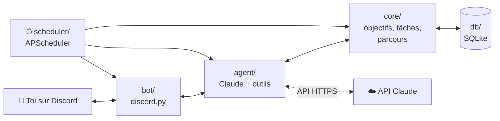

# Girlypop 💅 — mon agent perso sur Discord

Girlypop est un assistant personnel qui vit dans Discord (donc sur ton téléphone).
Elle :

- **récolte tes objectifs** (études, sport, pro, perso) ;
- te propose **chaque matin** un emploi du temps de la journée et **chaque semaine** un plan ;
- ajoute les **tâches que tu lui donnes** toi-même ;
- te **rappelle** tes tâches dans la journée et te **motive** à les faire ;
- construit des **parcours d'apprentissage** : si tu lui dis « je veux absolument trouver du temps
  pour les neurosciences et apprendre le crochet », elle découpe chaque sujet en sessions avec un
  thème intelligent (« Session 1 : le neurone et le potentiel d'action »…) et les place dans ton planning.

> 📚 **Commence par lire [`docs/ARCHITECTURE.md`](docs/ARCHITECTURE.md)** : il explique chaque
> « service », chaque techno et comment un message circule. Ensuite [`docs/ROADMAP.md`](docs/ROADMAP.md)
> donne les étapes pour faire grandir le projet.

---

## Vue d'ensemble en 10 secondes



Chaque couche ne parle qu'à sa voisine. Le cœur (`core/`) ne sait **rien** de Discord ni de l'IA :
on pourrait remplacer Discord par Telegram sans le toucher.

---

## Lancer le projet en local

Pré-requis : Python 3.11 ou plus.

```bash
# 1. Créer un environnement virtuel (une "bulle" Python rien que pour ce projet)
python3 -m venv .venv
source .venv/bin/activate          # sous Windows : .venv\Scripts\activate

# 2. Installer les dépendances
pip install -r requirements.txt

# 3. Créer ton fichier de secrets à partir du modèle
cp .env.example .env
#    puis ouvre .env et remplis DISCORD_TOKEN, DISCORD_OWNER_ID et ANTHROPIC_API_KEY
#    (la marche à suivre est dans docs/ROADMAP.md, étape 1)

# 4. Lancer le bot
python -m girlypop.main
```

Ensuite, envoie un message privé à ton bot sur Discord, par exemple :
« Salut ! Mes objectifs : réussir mes partiels, courir 3 fois par semaine, et apprendre les neurosciences. »

### Lancer les tests

```bash
pytest
```

Les tests vérifient le cœur métier **sans** Discord et **sans** appeler Claude, et font tourner la
boucle d'agent avec un *faux* Claude : c'est la preuve que les couches sont bien séparées.

---

## Arborescence

```
girly_bot/
├── README.md               ← tu es ici
├── docs/
│   ├── ARCHITECTURE.md     ← les services, les technos, les flux (à lire en premier)
│   └── ROADMAP.md          ← les étapes du projet
├── .env.example            ← modèle des secrets (le vrai .env n'est JAMAIS commité)
├── requirements.txt        ← les bibliothèques Python à installer
├── girlypop/
│   ├── main.py             ← point d'entrée : assemble toutes les couches
│   ├── config.py           ← lit le fichier .env
│   ├── db/                 ← couche données (SQLAlchemy + SQLite)
│   ├── core/               ← couche métier (objectifs, tâches, parcours, planning)
│   ├── agent/              ← couche IA (Claude + outils)
│   ├── bot/                ← couche Discord
│   └── scheduler/          ← les réveils automatiques (matin, semaine, rappels)
└── tests/
    ├── test_core.py        ← le cœur, tout seul
    └── test_agent.py       ← la boucle d'agent, avec un faux Claude
```

## ⚠️ Secrets

Ton token Discord et ta clé API Claude sont comme des mots de passe. Ils vont **uniquement** dans
`.env`, qui est listé dans `.gitignore` et ne part donc jamais sur GitHub. Si un jour tu en publies
un par erreur, régénère-le immédiatement (sur le portail Discord ou la console Claude).
