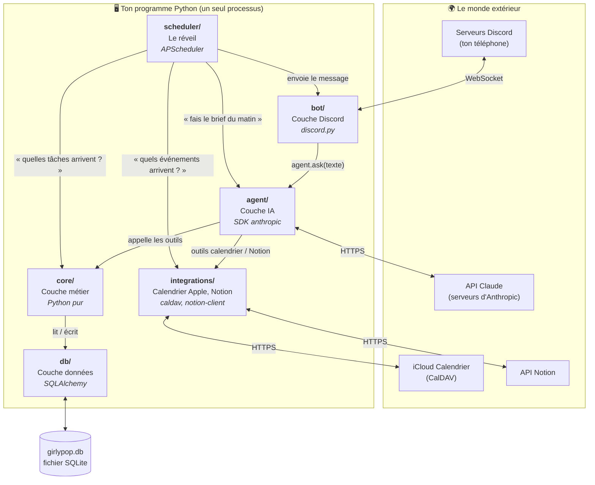
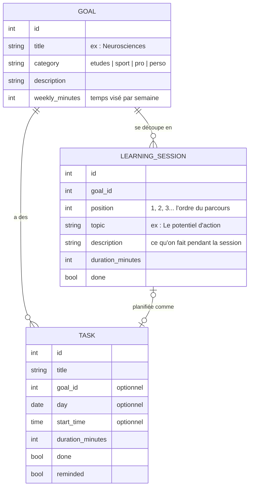
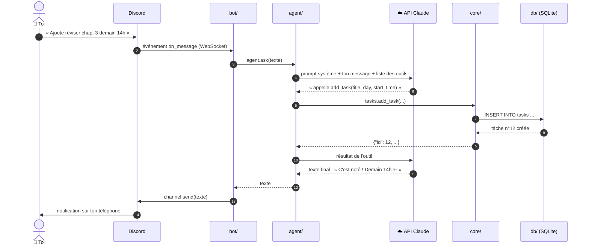
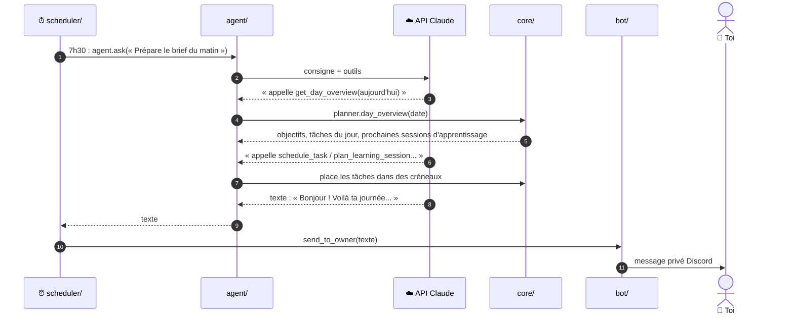
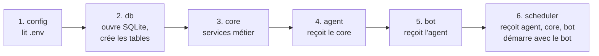

# Architecture de Girlypop

Ce document explique **comment les morceaux s'emboîtent**, sans qu'il soit nécessaire de lire le code.
Tu viens du C/C++ : je fais des parallèles avec ce que tu connais quand ça aide.

---

## 1. L'idée générale : des couches empilées

Imagine une pile de couches. Chaque couche a **un seul métier** et ne parle **qu'à ses voisines
directes**. C'est le même principe que séparer ton code C en `.h`/`.c` par module, mais à l'échelle
de toute l'application.

| Couche | Dossier | Son métier | Ce qu'elle ne fait **pas** |
|---|---|---|---|
| **Bot** | `girlypop/bot/` | Recevoir tes messages Discord, renvoyer les réponses | Elle ne réfléchit pas, ne touche pas à la base |
| **Agent** | `girlypop/agent/` | Comprendre ce que tu dis (via Claude) et décider quels outils utiliser | Elle ne stocke rien elle-même |
| **Cœur** | `girlypop/core/` | Les règles de ton organisation : objectifs, tâches, parcours, planning | Elle ne sait pas que Discord ou Claude existent |
| **Données** | `girlypop/db/` | Décrire les tables et ouvrir la connexion à SQLite | Aucune logique métier |
| **Scheduler** | `girlypop/scheduler/` | Réveiller l'application à heure fixe | Il ne sait pas *quoi* dire, il délègue |
| **Intégrations** | `girlypop/integrations/` | Parler aux services extérieurs : lire/écrire le calendrier Apple, créer des pages Notion | Facultatives : sans identifiants dans `.env`, elles ne sont pas créées et Claude ne voit pas leurs outils |

### Les trois rôles de Girlypop

| Rôle | Qui s'en occupe | Ce qu'il faut configurer |
|---|---|---|
| **Assistante de temps** : organiser tes jours et tes semaines | `agent/` (Claude planifie) + `core/planner.py` + `integrations/apple_calendar.py` | Calendrier Apple (facultatif mais conseillé) |
| **Motivatrice** : rappels, « on passe à la suite ? », encouragements, bilan du soir | `scheduler/jobs.py` (+ `agent/prompts.py` pour le ton) | Rien, juste les horaires dans `.env` |
| **Prof particulière** : fiches de cours dans Notion | `agent/` (Claude écrit le cours) + `integrations/notion.py` | Notion |

**Pourquoi c'est bien :**
- Tu peux tester le cœur sans Discord ni IA (c'est ce que fait `tests/test_core.py`).
- Tu peux changer une couche sans casser les autres : passer de SQLite à PostgreSQL ne touche que
  `db/`, passer de Discord à Telegram ne touche que `bot/`.
- Quand il y a un bug, tu sais dans quel dossier chercher.

---

## 2. Les technologies, une par une

### Python + `asyncio` (le moteur)
Tout tourne dans **un seul programme Python**. Il doit faire plusieurs choses « en même temps » :
écouter Discord, attendre la réponse de Claude, déclencher les rappels. Pour ça on utilise
`asyncio` : une **boucle d'événements** (event loop).

> Parallèle C : c'est comme une boucle `poll()`/`select()` qui surveille plusieurs descripteurs.
> Quand une fonction écrit `await quelque_chose`, elle dit « je vais attendre le réseau, occupe-toi
> d'autre chose pendant ce temps ». Pas de threads, pas de mutex.

### Discord + `discord.py` (l'interface)
- Tu crées une **application bot** sur le portail développeur Discord. Discord te donne un **token**
  (le mot de passe du bot).
- Au démarrage, `discord.py` ouvre une **connexion WebSocket** permanente vers Discord. Quand tu
  écris au bot, Discord pousse l'événement dans cette connexion et `discord.py` appelle notre
  fonction `on_message`.
- Pour répondre, on appelle `message.channel.send(...)` (une requête HTTPS vers Discord).
- Le bot ne répond **qu'à toi** (on vérifie ton identifiant `DISCORD_OWNER_ID`).

### Claude + SDK `anthropic` (le cerveau)
- On envoie à l'API Claude une requête HTTPS contenant : un **prompt système** (la personnalité et
  les règles de Girlypop), ton message, et la **liste des outils** disponibles.
- Un **outil** (tool), c'est une fonction de notre code décrite à Claude : son nom, à quoi elle sert,
  et ses paramètres (en JSON Schema). Exemple : `add_task(title, date, start_time)`.
- Claude ne peut pas exécuter notre code. Il **répond** « j'aimerais appeler `add_task` avec ces
  paramètres ». C'est **nous** qui exécutons la fonction, puis on lui renvoie le résultat. Il peut
  enchaîner plusieurs outils avant de formuler sa réponse finale. C'est ça, la **boucle d'agent**
  (détaillée en section 3).
- Modèle utilisé : `claude-opus-5-5`.

### SQLite + SQLAlchemy (la mémoire)
- **SQLite** est une base de données qui tient dans **un seul fichier** (`girlypop.db`). Pas de
  serveur à installer. Parfait pour un projet perso.
- **SQLAlchemy** est un **ORM** : au lieu d'écrire du SQL à la main, on décrit les tables comme des
  classes Python (`class Task: title, date, done...`) et on manipule des objets.
  > Parallèle C : une ligne de table ≈ une `struct`. SQLAlchemy fait la sérialisation
  > struct ↔ ligne SQL pour toi.

Les tables de départ :

### APScheduler (le réveil)
Un bot normal ne fait que **réagir** à tes messages. Mais Girlypop doit aussi **prendre
l'initiative** : t'écrire à 7h30, le dimanche soir, ou 10 minutes avant une tâche. APScheduler est
un « cron » intégré au programme : on lui dit « appelle cette fonction tous les jours à 7h30 ».

Les tâches planifiées de départ :

| Quand | Quoi | Qui fait le travail |
|---|---|---|
| Tous les jours à `MORNING_BRIEF_TIME` (7h30) | Brief du matin : planning du jour proposé | L'agent (Claude) |
| Chaque dimanche à `WEEKLY_PLAN_TIME` (19h) | Plan de la semaine | L'agent (Claude) |
| Toutes les 5 minutes | Rappels des tâches qui commencent bientôt | Le cœur (pas besoin d'IA, donc gratuit) |

### `.env` + `python-dotenv` (les secrets)
Les secrets (token Discord, clé API) et les réglages (fuseau horaire, heures des briefs) sont dans
un fichier `.env` qui **n'est jamais commité**. `config.py` le lit au démarrage. `.env.example`
montre la liste des variables sans les vraies valeurs.

### Docker (plus tard)
Pour que Girlypop tourne 24h/24, il faudra l'héberger sur un serveur (ton ordi ne reste pas allumé).
Docker emballe le programme et ses dépendances dans une « boîte » qui tourne pareil partout. C'est
une étape de la roadmap, pas nécessaire pour commencer.

---

## 3. Les flux : qui appelle qui, dans quel ordre

### Flux A — Tu écris un message

Exemple : « Ajoute "réviser le chapitre 3" demain à 14h ».

Les étapes 4 à 10 peuvent se répéter : Claude peut appeler `list_tasks` pour voir si le créneau est
libre, **puis** `add_task`, **puis** répondre. Le code de cette boucle est dans
`girlypop/agent/agent.py`, c'est le cœur de « l'agent ».

### Flux B — Le brief du matin (Girlypop prend l'initiative)

C'est exactement la même boucle que le flux A : la seule différence, c'est que le « message » vient
du réveil au lieu de venir de toi.

### Flux C — Un parcours d'apprentissage intelligent

Tu dis : « Je veux absolument trouver du temps pour les neurosciences et apprendre le crochet. »

1. Claude appelle `add_goal("Neurosciences", "perso", weekly_minutes=180)` et
   `add_goal("Crochet", "perso", weekly_minutes=120)`.
2. Claude **invente lui-même** un programme progressif et appelle `create_learning_path` avec une
   liste ordonnée de sessions :
   - 1. « Le neurone : anatomie et rôle » (45 min)
   - 2. « Le potentiel d'action expliqué simplement » (45 min)
   - 3. « Les synapses et les neurotransmetteurs » (45 min)
   - …
3. Le cœur enregistre ces sessions dans la table `learning_sessions`, dans l'ordre.
4. Au brief du matin ou au plan de la semaine, Claude voit « prochaine session neurosciences : n°2 »
   via `get_day_overview` et la place dans un créneau libre avec `plan_learning_session`, ce qui crée
   une **tâche** liée à la session.
5. Quand tu coches la tâche (`complete_task`), le cœur marque aussi la session comme faite, et la
   suivante devient « la prochaine ».

La **répartition des rôles** est la clé : Claude est bon pour *inventer* des thèmes pertinents et
*arbitrer* un planning ; le cœur est bon pour *se souvenir* de façon fiable et *appliquer des règles*
(l'ordre des sessions, ce qui est fait ou pas).

### Flux D — Les rappels (sans IA)

Toutes les 5 minutes, le scheduler demande au cœur : « quelles tâches non faites commencent dans les
15 prochaines minutes et n'ont pas encore été rappelées ? ». Pour chacune, il envoie un message via
le bot et marque la tâche `reminded = True`. Pas d'appel à Claude ici : c'est simple, rapide et
gratuit. (Une amélioration possible de la roadmap : demander à Claude un petit mot de motivation
personnalisé.)

---

## 4. Le démarrage : `main.py` assemble les pièces

`main.py` est le seul fichier qui connaît **toutes** les couches. Il les construit dans l'ordre,
de bas en haut, et donne à chacune les pièces dont elle a besoin (on appelle ça l'**injection de
dépendances**) :

> Parallèle C : c'est comme un `main()` qui fait les `init_xxx()` de chaque module et passe des
> pointeurs vers les structures dont les autres modules ont besoin, plutôt que d'utiliser des
> variables globales.

---

## 5. Où coûte l'argent, où sont les limites

- **Discord** : gratuit.
- **SQLite, APScheduler, discord.py** : gratuits, open source.
- **API Claude** : payante à l'usage (au nombre de « tokens » lus et écrits). Chaque message que tu
  envoies et chaque brief = un ou quelques appels. Les rappels n'appellent pas Claude.
- **Mémoire de conversation** : dans ce squelette, chaque message est traité indépendamment. Girlypop
  se « souvient » grâce à la base de données (objectifs, tâches), pas grâce à l'historique du chat.
  Garder l'historique des échanges est une étape de la roadmap.
